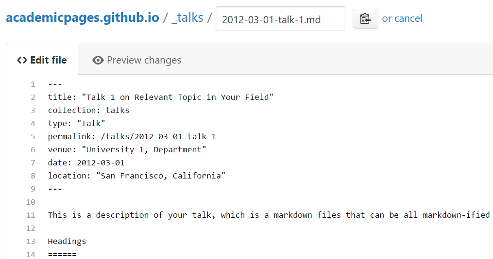

Astrophycist
======
I am an astrophysicist PhD student at UC San Diego, supervised by Prof. [Eve J Lee](https://evjhlee.github.io/). I focus on **planet formation and evolution**.

My research investigates the internal structure and evolution of rocky planets across a wide range of environments, from the early Earth to ultra-short-period exoplanets orbiting at the limits of planetary survival.

Example: editing a Markdown file for a talk

For more info
------
More info about configuring Academic Pages can be found in [the guide](https://academicpages.github.io/markdown/), the [growing wiki](https://github.com/academicpages/academicpages.github.io/wiki), and you can always [ask a question on GitHub](https://github.com/academicpages/academicpages.github.io/discussions). The [guides for the Minimal Mistakes theme](https://mmistakes.github.io/minimal-mistakes/docs/configuration/) (which this theme was forked from) might also be helpful.
